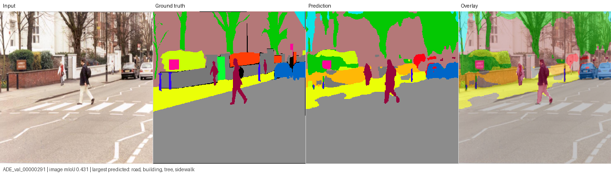
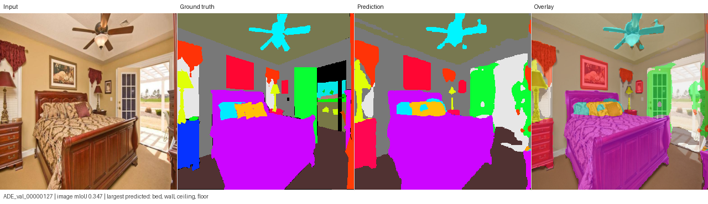
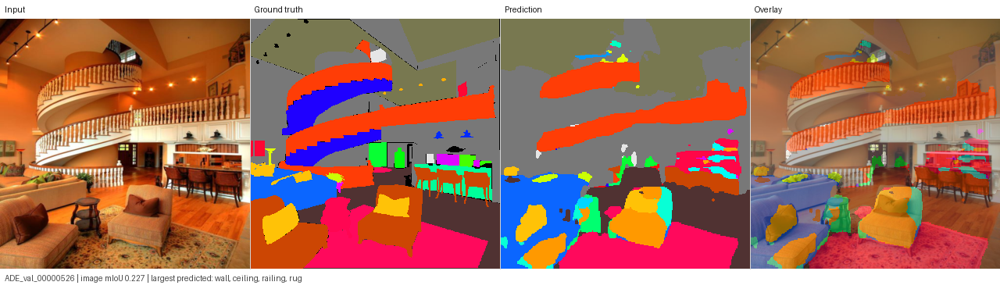
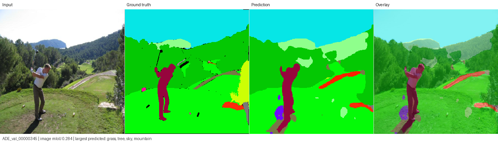

<div align="center">

<h2>VA-VAE (Encoder) + UPerNet 图像语义分割</h2>

**_基于 VA-VAE Encoder 与 UPerNet Head 的 ADE20K 语义分割实现_**

</div>

<div align="center">

<p><sub>ADE20K 验证集分割效果示例（输入 / 真值 / 预测 / 叠加，单图 mIoU 0.431）</sub></p>
</div>

---

## 📄 任务说明

本仓库使用 VA-VAE（encoder 部分）+ UPerNet 实现图像语义分割。

当前实现采用 **冻结 VA-VAE encoder + 训练 UPerNet head** 的方案，在 ADE20K 数据集上以 `256×256` 分辨率训练 20 轮，最终验证集 **mIoU 为 0.3477**、**Pixel Accuracy 为 0.7583**。该结果对应「重建预训练特征 + 固定 encoder + 256×256 输入尺寸」的实验设定。

---

## 🔧 实现方案：VA-VAE 与 UPerNet 的衔接

整体流程为：输入图像（`[-1, 1]` 归一化）送入冻结的 VA-VAE encoder 提取四级多尺度特征，再接入 UPerNet head（PPM + FPN）完成通道对齐、多尺度融合与像素级分类。

### 1. 多尺度特征流转（以 256×256 输入为例）

| 阶段        | 来源模块                                 | 输出尺寸              | 通道数 | 下采样倍率  |
| --------- | ------------------------------------ | ----------------- | --- | ------ |
| 输入图像      | 数据预处理（`[-1, 1]`）                     | `3 × 256 × 256`   | 3   | `1`    |
| Feature 1 | `encoder.down[2]`                    | `256 × 64 × 64`   | 256 | `1/4`  |
| Feature 2 | `encoder.down[3]`                    | `256 × 32 × 32`   | 256 | `1/8`  |
| Feature 3 | `encoder.down[4]` → `encoder.mid`    | `512 × 16 × 16`   | 512 | `1/16` |
| Feature 4 | `avg_pool2d(Feature 3, 2, 2)`        | `512 × 8 × 8`     | 512 | `1/32` |
| 分割输出      | UPerNet Head（PPM + FPN + Classifier） | `150 × 256 × 256` | 150 | `1`    |

### 2. VA-VAE Encoder 特征提取（`upernet/vavae_backbone.py`）

- 复用 `LightningDiT/tokenizer/autoencoder.py` 中的 `AutoencoderKL` 结构（`embed_dim=32, ch_mult=(1, 1, 2, 2, 4)`），从 `vavae-imagenet256-f16d32-dinov2.pt` 加载 `encoder.*` 权重。
- 手动展开 `encoder.down` 的逐级前向过程，依次在 `1/4`、`1/8`、`1/16`（经 `encoder.mid`）处截取出三级特征图。
- 对 `1/16` 特征做无参数的 `avg_pool2d(kernel_size=2, stride=2)` 构造 `1/32` 特征，满足 UPerNet 四级输入要求且不引入额外可训练层。

### 3. UPerNet Head 对接与初始化（`upernet/vavae_upernet.py`）

- 独立实现与 HuggingFace `UperNetForSemanticSegmentation` 同构的 **PPM + FPN** 解码头，不依赖 `transformers` 或 `mmsegmentation`。
- **通道对齐**：VA-VAE 输出通道为 `[256, 256, 512, 512]`，由 UPerNet head 内部的 `lateral_convs`（3 个 `1×1` 卷积，统一映射至 512 通道）、`psp_modules`（4 个 `1×1` 卷积）与 `bottleneck`（`2560 → 512`）直接完成通道适配，随 head 一并训练，无需外挂独立适配层。
- **部分预训练初始化**：加载 `openmmlab/upernet-swin-tiny` 权重时按参数形状匹配过滤——`fpn_convs`、`fpn_bottleneck`、`classifier` 及全部 BN 共 **66 个张量**成功加载；其余 8 个因输入通道数不同（Swin-T 为 `[96, 192, 384, 768]`）而形状不匹配的张量保持随机初始化。

### 4. 骨干冻结机制

- 启用 `--freeze-backbone` 后，冻结 VA-VAE encoder 的全部 **69.84M** 参数，仅训练 `decode_head` 的 **29.97M** 参数（模型总参数量 **99.81M**）。
- 前向传播时强制保持 backbone 为 `eval()` 模式并置于 `torch.no_grad()` 中，避免更新 BN 统计量并减少显存占用。

---

## ⚙️ 训练方法

### 1. 数据集与预处理

- **数据划分**：使用 ADE20K 官方划分，训练集 `images/training` + `annotations/training` 共 **20,210** 对，验证集 `images/validation` + `annotations/validation` 共 **2,000** 对（官方 test 集无公开标注，评测在验证集上进行）。
- **同步预处理**：图像与 mask 同步 resize 至 `256×256`（图像双线性插值，mask 最近邻插值），训练集以 `0.5` 概率同步水平翻转。
- **数值与标签映射**：图像归一化至 `[-1, 1]`（匹配 VA-VAE 输入范围）；ADE20K 单通道 PNG 标注中 `0`（未标注）映射为 `255`（loss 忽略），`1..150` 映射为 `0..149`。

### 2. 训练超参数配置

| 配置项 | 设置 |
|---|---|
| 损失函数 | CrossEntropyLoss（`ignore_index=255`） |
| 优化器 | AdamW，weight decay `1e-4`（norm / bias 不做权重衰减） |
| 学习率与调度 | head 初始 `1e-3`，200 步 warmup + poly 衰减（`power=0.9`） |
| Batch Size / 精度 | `4`（需 `>= 2` 以满足 PPM 池化后 BN 要求），AMP（FP16） |
| 梯度策略 | 梯度裁剪阈值 `1.0`，支持梯度累积 |
| 输入尺寸 | `256×256`（需为 32 的倍数） |
| 训练轮数与评测 | 20 轮，每轮在 2,000 张验证图上计算 mIoU 与 pixel accuracy，保存最优权重 |

### 3. 硬件与训练开销

| 项目   | 记录                              |
| ---- | ------------------------------- |
| 硬件设备 | 单卡 GPU（未启用 DDP）                 |
| 显存峰值 | 估算 2～3 GB，8 GB 显卡可运行            |
| 训练耗时 | 每轮约 14.1 分钟，20 轮总计约 4.7 小时      |

---

## 📝 实验结果与可视化

### 1. 验证集指标

| 指标 | 数值 |
|---|---|
| 验证集 mIoU | **0.3477**（第 20 轮） |
| 验证集 Pixel Accuracy | **0.7583** |
| 验证集 Loss 最低 | 0.8382（第 13 轮） |
| 训练 Loss | 1.376 → 0.524 |

- **收敛过程**：验证集 mIoU 第 1 轮为 `0.199`，第 13 轮升至 `0.340`，第 20 轮达到 `0.348`。第 13 轮后验证集 loss 从 `0.838` 略升至 `0.868`，mIoU 在 `0.338～0.348` 区间小幅波动；随着 poly 学习率在第 20 轮降至 0，只训 head 的曲线已进入平台期。

### 2. 分割效果预览

四格从左到右依次为：**输入图像 / 真值（GT）/ 模型预测 / 预测叠加原图**。配色采用 mmsegmentation 的 ADE20K 150 类调色板，真值中未标注区域为黑色。单图 mIoU 在 `256×256` 空间计算。

<div align="center">


<p><b>ADE_val_00000127（卧室，单图 mIoU 0.347）</b>：bed、wall、ceiling、floor 等大面积区域基本准确，床与墙的边界较真值偏碎。</p>


<p><b>ADE_val_00000526（室内，单图 mIoU 0.227）</b>：四张中预测类别最多（27 类），小物件错分较明显。</p>


<p><b>ADE_val_00000291（街景，单图 mIoU 0.431）</b>：road、building、tree、sidewalk 等主要区域基本对齐。</p>


<p><b>ADE_val_00000345（户外山景，单图 mIoU 0.284）</b>：grass、tree、sky 大块区域分离清晰，山体与树木边界存在混淆。</p>

</div>

### 3. 训练产出（`checkpoints/`）

| 文件                          | 说明                                                |
| --------------------------- | ------------------------------------------------- |
| `best.pth`                  | 第 20 轮最优权重，399 MB，仅含模型参数                          |
| `last.pth`                  | 第 20 轮完整训练状态，639 MB，含优化器 / 调度器 / scaler           |
| `metrics.csv`               | 每轮 `train_loss`、`val_loss`、`mIoU`、`pixel_acc` 与耗时 |
| `train.log`                 | 完整训练日志                                            |

---

## 🎯 代码结构与运行方式

### 目录结构

```text
.
├── README.md                              # 项目说明（本文件）
├── vavae-imagenet256-f16d32-dinov2.pt     # VA-VAE 预训练权重
├── upernet/
│   ├── vavae_backbone.py                  # VA-VAE encoder 多尺度特征提取
│   ├── vavae_upernet.py                   # UPerNet head、整体模型、HF 权重加载
│   ├── train.py                           # 数据加载、训练、评测与续训入口
│   ├── visualize.py                       # 推理并生成四格分割预览图
│   ├── ade_palette.py                     # ADE20K 150 类名称与配色
│   ├── README.md                          # 训练硬件配置、依赖与启动说明
│   └── requirements.txt                   # 运行依赖
├── data/
│   ├── ADEChallengeData2016/              # ADE20K 图像与标注
│   └── upernet-swin-tiny-pytorch_model.bin# UPerNet 预训练头权重
├── checkpoints/                           # 训练权重与日志
├── docs/images/                           # 分割预览图
└── LightningDiT/                          # 上游代码库（仅使用 tokenizer/autoencoder.py）
```

> **注意**：`vavae_backbone.py` 会将 `LightningDiT/` 加入 `sys.path`，请勿移动或重命名该目录。

### 环境安装与运行命令

#### 1. 环境要求

- **Python**：3.9+
- **核心框架**：CUDA 版 `torch >= 2.0`、`torchvision >= 0.15`（需与本机 CUDA 驱动匹配）
- **其他依赖**（见 `upernet/requirements.txt`）：`numpy>=1.24`、`pillow>=9.0`、`requests>=2.28`、`tqdm>=4.65`（不依赖 `transformers` 或 `mmsegmentation`）

```bash
pip install -r upernet/requirements.txt
```

#### 2. 数据与权重准备

以下文件因体积限制未随仓库上传，请通过对应链接获取并放到指定路径：

| 本地路径                                       | 说明                       | 资源链接                                                                                                |
| ------------------------------------------ | ------------------------ | --------------------------------------------------------------------------------------------------- |
| `vavae-imagenet256-f16d32-dinov2.pt`       | VA-VAE encoder 预训练权重（必需） | [HuggingFace](https://huggingface.co/hustvl/vavae-imagenet256-f16d32-dinov2)                        |
| `data/ADEChallengeData2016/`               | ADE20K 数据集（必需，解压至此目录）    | [ADEChallengeData2016.zip](https://data.csail.mit.edu/places/ADEchallenge/ADEChallengeData2016.zip) |
| `checkpoints/best.pth`                     | 本次训练好的分割权重（评测 / 可视化用）    | [GitHub Release v1.0 (`best.pth`)](https://github.com/mizukuChen/VAVAE-UPerNet-Segmentation/releases/download/v1.0/best.pth) |
| `data/upernet-swin-tiny-pytorch_model.bin` | UPerNet 预训练头权重（仅从头训练时需要） | [HuggingFace](https://huggingface.co/openmmlab/upernet-swin-tiny)（下载 `pytorch_model.bin` 后重命名）      |

#### 3. 评测与可视化（使用 Release 权重）

将 `best.pth` 放入 `checkpoints/` 后，即可直接复现验证集指标与分割预览图：

```bash
# 在 2000 张 ADE20K 验证图上评测权重
python upernet/train.py --resume checkpoints/best.pth --eval-only

# 重新生成四张典型分割预览图
python upernet/visualize.py --ckpt checkpoints/best.pth --output-dir docs/images \
  --images ADE_val_00000127 ADE_val_00000526 ADE_val_00000291 ADE_val_00000345
```

#### 4. 启动训练

如需**从头复现训练**，或查看训练所需的**硬件配置与启动说明**，请查阅 👉 [`upernet/README.md`](upernet/README.md)。

---

## 📦 代码与数据来源

| 名称 | 用途 | 大小 | 来源 |
|---|---|---|---|
| `LightningDiT/` | VA-VAE `tokenizer/autoencoder.py` 中的 encoder 定义 | — | [hustvl/LightningDiT](https://github.com/hustvl/LightningDiT)（VA-VAE, CVPR 2025） |
| `vavae-imagenet256-f16d32-dinov2.pt` | 冻结的 VA-VAE encoder 权重 | 约 2.0 GB | [hustvl/vavae-imagenet256-f16d32-dinov2](https://huggingface.co/hustvl/vavae-imagenet256-f16d32-dinov2) |
| `upernet-swin-tiny-pytorch_model.bin` | UPerNet head 部分预训练初始化权重 | 约 229 MB | [openmmlab/upernet-swin-tiny](https://huggingface.co/openmmlab/upernet-swin-tiny) |
| `ADEChallengeData2016.zip` | ADE20K 训练 / 验证图像与像素级标注 | 约 922 MB（解压约 2.3 GB） | [MIT CSAIL ADE20K](https://data.csail.mit.edu/places/ADEchallenge/ADEChallengeData2016.zip) |
| ADE20K 类别名与配色 | 分割预览图 150 类上色 | 150 类 | [mmsegmentation `ADE20KDataset.METAINFO`](https://github.com/open-mmlab/mmsegmentation/blob/main/mmseg/datasets/ade.py) |
